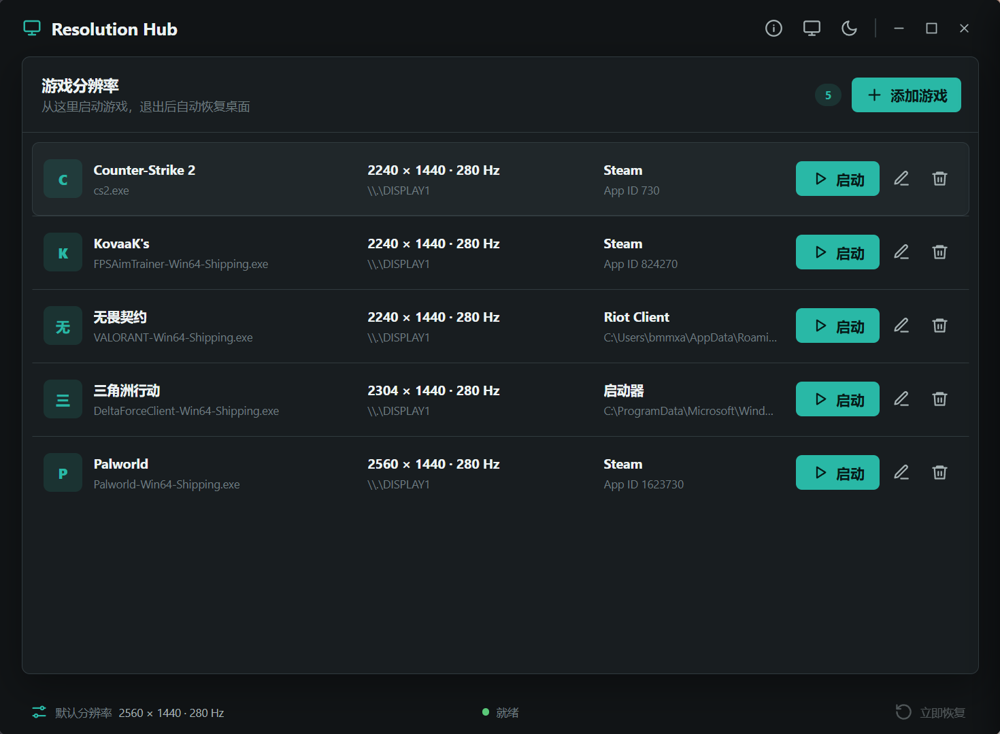
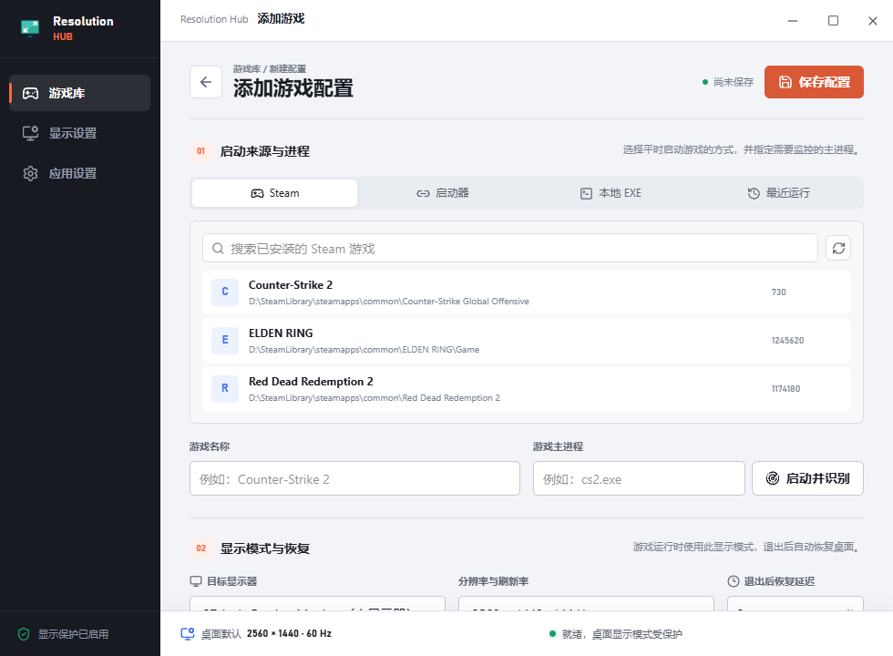
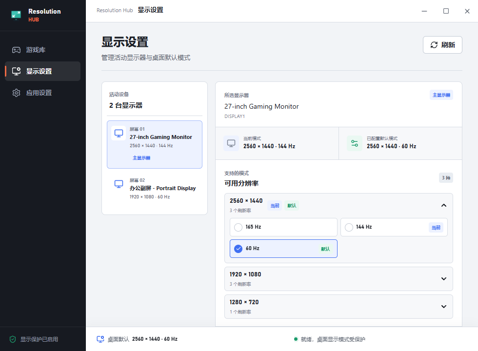

# Resolution Hub

> **Juice 借助 Codex 进行开发。**

[](https://github.com/bmmxat/resolution-hub/releases/latest)


[](LICENSE)

Resolution Hub 是一款 Windows 游戏分辨率启动器。它从统一界面启动游戏，
在合适的时机切换目标显示器的分辨率与刷新率，并在游戏退出后自动恢复桌面显示模式。

<p align="center">
  
</p>

## 下载

前往 [Releases](https://github.com/bmmxat/resolution-hub/releases/latest)
下载最新的 Windows x64 便携版，双击即可运行，无需安装。

运行要求：

- Windows 10/11 x64
- Microsoft Edge WebView2 Runtime（现代 Windows 系统通常已预装）

便携版表示程序无需安装；游戏配置与软件设置仍保存在
`%APPDATA%\resolution-hub`。当前版本未进行商业代码签名，Windows SmartScreen
可能显示安全提示。

## 核心功能

### 按游戏切换显示模式

- 为每个游戏分别设置目标显示器、分辨率和刷新率。
- 支持“启动命令之前”和“检测到游戏主进程时”两种切换时机。
- 游戏退出后自动恢复用户设置的桌面默认模式。
- 支持多显示器，并可为每台显示器保存独立的默认模式。

### 多种游戏添加方式

- **Steam**：扫描本机 Steam 库和已安装游戏，无需 Steam API Key。
- **登录器 / 启动器**：适用于 Riot Client、Epic、Battle.net 等平台。
- **本地游戏**：直接选择游戏可执行文件。
- **最近运行**：从最近活动的应用中识别可执行文件和进程名。

<p align="center">
  
</p>

启动器模式会等待真正的游戏主进程出现后再切换显示模式，避免在登录、更新阶段
提前修改分辨率。“启动并识别”可帮助首次使用的用户确定游戏主进程，识别期间不会
切换显示模式。

### 自动接管外部启动的游戏

开启“自动接管”后，Resolution Hub 会监控已添加且允许自动接管的游戏进程。
游戏可以继续从桌面、Steam 或其他启动器打开，不必先从 Resolution Hub 启动。

- 游戏库、应用设置和系统托盘中的全局开关保持同步。
- 每个游戏可单独关闭“允许自动接管”。
- 多个已配置游戏同时运行时优先接管当前前台游戏，非游戏窗口不会打断当前接管。
- 所有受监控游戏退出或关闭全局开关后，会安全恢复桌面显示模式。
- 自动接管要求 Resolution Hub 保持运行，可将主窗口隐藏到系统托盘。

### 分辨率与刷新率二级选择

显示器选择固定在面板顶部，分辨率按像素大小排序。展开一个分辨率后，再选择该
分辨率支持的刷新率，更贴合以修改分辨率为主的使用场景。

<p align="center">
  
</p>

### 恢复与安全

- 切换前验证目标显示模式是否仍受当前显示器支持。
- 按游戏主进程监控运行状态，避免将启动器退出误判为游戏退出。
- 保存异常恢复点；程序意外退出后，下次启动会提示恢复桌面模式。
- 支持取消启动等待、配置等待超时以及手动“立即恢复”。
- 支持当前用户的 Windows 开机自启开关。
- 系统托盘支持切换自动接管、快速启动最常用的 5 个游戏、手动恢复和安全退出。

## 使用流程

1. 添加游戏并选择 Steam、启动器、本地游戏或最近运行。
2. 选择游戏主进程、目标显示器、分辨率和刷新率。
3. 从 Resolution Hub 启动游戏；或开启自动接管后照常从外部启动。
4. 程序在配置的时机或检测到外部游戏进程后切换显示模式。
5. 游戏退出后，程序恢复桌面默认模式。

## 技术栈

- Rust 2024
- Tauri 2
- windows-rs
- React 19
- Vite 8
- TypeScript
- Tailwind CSS 4

## 开发

安装前端工具并启动 Tauri 开发模式：

```powershell
npm install
npm run dev
```

仅启动浏览器中的前端开发服务器：

```powershell
npm run dev:web
```

仅编译开发版：

```powershell
cargo build
```

开发可执行文件位于 `target\debug\resolution-hub.exe`。

### 测试

```powershell
npm run typecheck
npm test
npm run build:web
cargo fmt --check
cargo test
```

前端源码位于 `frontend\src`，Vite 构建产物输出到 `dist`。所有 Tauri API
调用和 `runtime-status` 事件订阅统一收口在 `frontend\src\lib\tauri.ts`。

### 构建

生成 NSIS 安装包：

```powershell
npm run build
```

仅生成免安装的 Release 可执行文件：

```powershell
npm run build -- --no-bundle
```

Release 可执行文件位于 `target\release\resolution-hub.exe`。

## 本地数据

用户数据保存在 `%APPDATA%\resolution-hub\`：

| 文件 | 用途 |
| --- | --- |
| `profiles.json` | 游戏配置 |
| `profile-usage.json` | 托盘快捷启动排序所用的本地计数 |
| `settings.json` | 默认桌面模式与全局应用偏好 |
| `recent-apps.json` | 本机最近活动应用历史 |
| `pending-restore.json` | 异常退出时的临时恢复点 |

Steam 游戏列表仅读取本机 Steam 注册表、`libraryfolders.vdf` 和
`appmanifest_*.acf`。开机自启使用当前用户注册表项：

```text
HKCU\Software\Microsoft\Windows\CurrentVersion\Run
```

## 当前范围

- 支持由 Resolution Hub 启动，也支持驻留托盘后自动接管外部启动的游戏。
- 启动器模式依赖游戏主进程名；首次添加时建议使用“启动并识别”。
- 支持关闭主窗口后驻留系统托盘；当前不包含开机后的后台静默启动。
- 仅面向 Windows，显示模式切换依赖 Windows Display API。

## 许可证

本项目基于 [MIT License](LICENSE) 开源。
